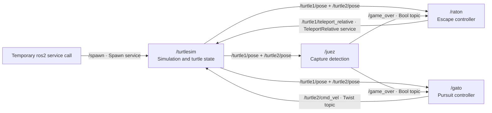

# Cat and mouse game with ROS 2

This workspace contains `py_raton_gato`, a Python ROS 2 package that runs an autonomous cat and mouse game in **turtlesim**. The Spanish names used in the code are `raton` (mouse), `gato` (cat), and `juez` (referee).

- **Mouse — `turtle1`:** the turtle created automatically by turtlesim. It escapes by teleporting away from the cat at regular intervals.
- **Cat — `turtle2`:** spawned at `(1.0, 2.0)` with orientation `0.0`. It continuously drives toward the mouse.
- **Referee:** measures the distance between the turtles. When the distance is strictly less than the capture threshold, it announces the end of the game and both controllers stop issuing movement commands.

There is no keyboard control or round restart logic. Relaunch the game to start a new round.

## Repository structure

```text
src/py_raton_gato/
├── config/juego.yaml           # Parameters for the three game controllers
├── launch/juego.launch.py      # Starts turtlesim, spawning, and the controllers
├── py_raton_gato/
│   ├── __init__.py             # Python package marker
│   ├── raton.py                # Mouse escape controller
│   ├── gato.py                 # Cat pursuit controller
│   ├── juez.py                 # Capture detection and game-over notification
│   └── spawner.py              # Alternative spawner, unused by the launch file
├── resource/py_raton_gato      # ament package index marker
├── test/                      # Python style and copyright checks
├── package.xml                # ROS package metadata
├── setup.py                   # Python packaging, installed files, executables
└── setup.cfg                  # Installation location of ROS executables
```

The workspace-level `build/`, `install/`, and `log/` directories are generated by colcon. Edit the source under `src/`, then rebuild to update the installed package.

## Run the game

You need a sourced ROS 2 installation, Python support for `rclpy`, `turtlesim`, `geometry_msgs`, `std_msgs`, `launch`, and `launch_ros`, plus colcon. Turtlesim needs a graphical desktop/display. The current `package.xml` does not declare these runtime dependencies, so ensure they are installed before building.

From the workspace root, using your installed ROS distribution in place of `<distro>`:

```bash
source /opt/ros/<distro>/setup.bash
colcon build --packages-select py_raton_gato
source install/setup.bash
ros2 launch py_raton_gato juego.launch.py
```

The launch file reads the installed `config/juego.yaml`. After editing the source configuration, rebuild and source the workspace again. Press **Ctrl+C** in the launch terminal to stop the application.

## Overall ROS graph

The normal launch runs four nodes: `/turtlesim`, `/raton`, `/gato`, and `/juez`. It also runs a temporary `ros2 service call` process to spawn `turtle2`; this process is not a persistent game controller.



The diagram shows the connections used by the game. The cat also subscribes to `/raton_jump`, but no node in this repository publishes that topic.

### Topics

Names below are the resolved names for the supplied launch file, which uses the root namespace. All explicitly created publishers and subscriptions in the Python game nodes use queue depth `10`.

| Topic | Message type | Publisher | Subscriber(s) | Purpose |
| --- | --- | --- | --- | --- |
| `/turtle1/pose` | `turtlesim/msg/Pose` | `/turtlesim` | `/raton`, `/gato`, `/juez` | Mouse position and orientation, plus linear and angular velocity. |
| `/turtle2/pose` | `turtlesim/msg/Pose` | `/turtlesim`, after spawning the cat | `/raton`, `/gato`, `/juez` | Cat position and orientation, plus linear and angular velocity. |
| `/turtle2/cmd_vel` | `geometry_msgs/msg/Twist` | `/gato` | `/turtlesim` | Commands the cat's forward velocity (`linear.x`) and turning velocity (`angular.z`). |
| `/game_over` | `std_msgs/msg/Bool` | `/juez` | `/raton`, `/gato` | A single `True` message announces capture. |
| `/raton_jump` | `std_msgs/msg/Empty` | **None in the current implementation** | `/gato` | Each received message increases the cat's internal maximum speed. |

The mouse does not publish `/turtle1/cmd_vel`: its movement uses a teleport service instead. Standard ROS infrastructure topics and additional turtlesim interfaces are outside this game-specific graph.

### Services

| Service | Service type | Server | Client | Purpose |
| --- | --- | --- | --- | --- |
| `/spawn` | `turtlesim/srv/Spawn` | `/turtlesim` | Temporary process in `juego.launch.py` | Creates `turtle2` at the requested position and orientation. The response contains its name. |
| `/turtle1/teleport_relative` | `turtlesim/srv/TeleportRelative` | `/turtlesim` | `/raton` | Applies the mouse's relative rotation (`angular`) and displacement (`linear`). |
| `/turtlesim/spawn` | `turtlesim/srv/Spawn` | **No server configured by this launch** | `/spawner`, only if run separately | Endpoint used by the unused alternative spawner. It differs from the active `/spawn` endpoint. |

None of the Python game nodes creates a custom service server or ROS action. They use standard message and service types; the repository defines no custom `.msg`, `.srv`, or `.action` interfaces.

### Sequence of a round

1. `juego.launch.py` starts turtlesim, the spawn command, and all three controllers. These actions have no explicit startup ordering or launch event dependencies.
2. Turtlesim creates the mouse (`turtle1`). The spawn command requests the cat (`turtle2`) through `/spawn`.
3. The mouse waits for its teleport service before finishing initialization. All three controllers wait for both turtles' poses before performing their game logic.
4. Every `1.0` second with the default configuration, the mouse requests an escape jump. Every `0.05` seconds, the cat calculates and publishes a pursuit command. Turtlesim updates the turtles and publishes their poses.
5. Every `0.1` seconds, the referee checks the distance. If it is below `1.0`, it publishes `/game_over = True` once.
6. The mouse stops making new teleport requests. The cat publishes a zero `Twist` and stops publishing pursuit commands. The nodes and turtlesim window remain running until shutdown.

## What each Python file does

### `py_raton_gato/raton.py` — mouse controller

Defines `RatonNode`, with node name `/raton`.

- **Subscribers:** `/turtle1/pose` → `raton_callback`, `/turtle2/pose` → `gato_callback`, and `/game_over` → `game_over_callback`.
- **Publishers:** none.
- **Service client:** `turtle1/teleport_relative` (`TeleportRelative`). This name is relative; it resolves to `/turtle1/teleport_relative` in the supplied launch.
- **Service servers / actions:** none.
- **Timer:** `control_loop`, every `timer_period` seconds.

The pose callbacks store the latest mouse and cat positions. The control loop returns until both poses are available, and returns permanently after receiving a `True` game-over message.

Away from the walls, it calculates the angle from the mouse to the cat with `atan2`, adds π to face away, and subtracts the mouse's current orientation. It normalizes this relative turn to `[-π, π]` and sends it as `request.angular`, with `jump_linear` as `request.linear`.

`is_near_wall()` checks whether the mouse is within `0.5` units of a boundary, using a hard-coded world maximum of `11.0`. Near a wall, `get_tangential_direction()` chooses a direction offset by ±π/2 from the direction toward the cat: +π/2 at the left/bottom walls, −π/2 at the right/top walls. The control loop uses that direction for the next jump. This is a wall escape heuristic, not a guarantee of collision-free movement.

Teleport calls are asynchronous; their futures and responses are not checked. A request already sent before game over is not cancelled. `jump_angular` is declared and loaded from YAML but is not used in the movement calculation.

### `py_raton_gato/gato.py` — cat controller

Defines `GatoNode`, with node name `/gato`.

- **Subscribers:** `/turtle2/pose` → `gato_callback`, `/turtle1/pose` → `raton_callback`, `/game_over` → `game_over_callback`, and `/raton_jump` → `jump_callback`.
- **Publisher:** `/turtle2/cmd_vel` (`Twist`).
- **Service clients / servers / actions:** none.
- **Timer:** `control_loop`, every `0.05` seconds (**20 Hz**).

Once both poses are known, the cat uses proportional control to pursue the mouse:

```text
dx = mouse.x - cat.x
dy = mouse.y - cat.y
distance = sqrt(dx² + dy²)
heading_error = normalize(atan2(dy, dx) - cat.theta)

linear.x  = min(linear_gain * distance, max_linear_speed)
angular.z = angular_gain * heading_error
```

There is no explicit angular velocity limit or pause in forward motion while turning. Each `/raton_jump` message adds `speed_increment` to the internal `max_linear_speed` attribute. This does not update the ROS parameter value, and the normal game never triggers it because the mouse does not publish jump events.

On `/game_over = True`, the cat sets its stop flag and immediately publishes a zero `Twist`. Subsequent timer callbacks return without publishing movement.

### `py_raton_gato/juez.py` — referee

Defines `JuezNode`. Its constructor names it `juez_node`; the launch file overrides the runtime name to `/juez`, matching the YAML configuration key.

- **Subscribers:** `/turtle1/pose` → `raton_callback`, `/turtle2/pose` → `gato_callback`.
- **Publisher:** `/game_over` (`Bool`).
- **Service clients / servers / actions:** none.
- **Timer:** `check_capture`, every `0.1` seconds (**10 Hz**).

The referee stores both poses and checks their Euclidean distance. When `distance < capture_distance`, it sets its own `game_over` flag, publishes `Bool(data=True)`, and logs the capture. The flag prevents repeat announcements. It does not publish `False` at startup or reset the game.

The game-over publisher uses the default volatile durability and publishes only once, so the notification is not retained for controllers that join after capture.

### `py_raton_gato/spawner.py` — unused alternative spawner

Defines `SpawnerNode`, with node name `/spawner`. It has no topic publishers, topic subscribers, service servers, actions, or timers. Its only game interface is a `Spawn` service client at `/turtlesim/spawn`.

The constructor waits for that service, checking once per second and giving up after approximately 10 seconds. If available, `spawn_turtle()` asynchronously requests `turtle2` at `(1.0, 2.0, 0.0)`. `callback()` logs the result or failure and shuts down the ROS context after completion.

**This file does not participate in the supplied game launch.** Its console entry point is commented out in `setup.py`, so `ros2 run py_raton_gato spawner` is not installed. It also targets `/turtlesim/spawn`, whereas the active launch uses `/spawn`. To adopt it, its endpoint and packaging/launch integration would need to be aligned with the running simulator.

### `launch/juego.launch.py` — game assembly

`generate_launch_description()` locates `config/juego.yaml` in the installed package share directory and returns the actions that start:

| Action | Executable | Runtime node name / role |
| --- | --- | --- |
| Turtlesim `Node` | `turtlesim/turtlesim_node` | `/turtlesim`, simulation and turtle interfaces |
| Spawn `ExecuteProcess` | `ros2 service call /spawn turtlesim/srv/Spawn ...` | Temporary service client creating the cat |
| Mouse `Node` | `py_raton_gato/raton` | `/raton` |
| Cat `Node` | `py_raton_gato/gato` | `/gato` |
| Referee `Node` | `py_raton_gato/juez` | `/juez` |

The same YAML file is passed to the three game nodes; each receives the parameters under its own node name. The launch file itself is not a game node and creates no gameplay publishers or subscriptions.

### Packaging and test Python files

| File | Role |
| --- | --- |
| `py_raton_gato/__init__.py` | Empty Python package marker; contains no game logic or ROS interfaces. |
| `setup.py` | Discovers Python packages, installs the launch/YAML files, and registers the `raton`, `gato`, and `juez` console executables with their `main()` functions. The `spawner` entry is commented out. |
| `test/test_flake8.py` | Runs the ament Flake8 style checks. Does not test game behavior. |
| `test/test_pep257.py` | Runs the ament PEP 257 docstring checks. Does not test game behavior. |
| `test/test_copyright.py` | Contains the ament copyright check, currently skipped by a pytest decorator. |

The controller `main()` functions initialize `rclpy`, construct their node, spin to process callbacks, then destroy the node and shut down. None of the packaging or test files is a gameplay node.

## Configuration

Defaults below come from [`src/py_raton_gato/config/juego.yaml`](src/py_raton_gato/config/juego.yaml), rather than defaults in the Python parameter declarations.

| Node | Parameter | YAML value | Effect |
| --- | --- | --- | --- |
| `/raton` | `timer_period` | `1.0` | Seconds between escape attempts. |
| `/raton` | `jump_linear` | `2.0` | Displacement requested per jump, in turtlesim world units. |
| `/raton` | `jump_angular` | `1.5` | Loaded but unused; actual rotation is calculated from the poses. |
| `/gato` | `max_linear_speed` | `1.0` | Initial forward speed limit, in world units per second. |
| `/gato` | `linear_gain` | `1.0` | Converts distance to requested forward speed. |
| `/gato` | `angular_gain` | `4.0` | Converts heading error in radians to turning speed in radians per second. |
| `/gato` | `speed_increment` | `0.01` | Increase in the internal speed limit per `/raton_jump` message; inactive without a publisher. |
| `/juez` | `capture_distance` | `1.0` | Capture occurs strictly below this distance, in world units. |

The cat/referee timer periods, mouse wall margin/world limit, and cat spawn position are hard-coded. Parameters are copied into Python attributes during initialization; there are no callbacks that apply later ROS parameter changes to those attributes. Restart the game with updated configuration to change these settings reliably.

When running a controller separately, supply the YAML and the correct node name. In particular, the referee needs the launch-style name override for its `juez` parameter section:

```bash
ros2 run py_raton_gato juez --ros-args -r __node:=juez --params-file src/py_raton_gato/config/juego.yaml
```

This starts only the referee; turtlesim and the other controllers must already be running for a complete game.

## Inspect the running game

In another terminal, source ROS 2 and `install/setup.bash`, then use:

```bash
ros2 node list
ros2 node info /raton
ros2 node info /gato
ros2 node info /juez
ros2 topic list -t
ros2 topic info /raton_jump --verbose
ros2 topic echo /turtle1/pose
ros2 service list -t
ros2 service type /spawn
ros2 param list /gato
```

To observe the single capture notification, start `ros2 topic echo /game_over` **before capture**. An `rqt_graph` installation can also display the live topic connections; use the service table above to understand the teleport and spawn relationships.
